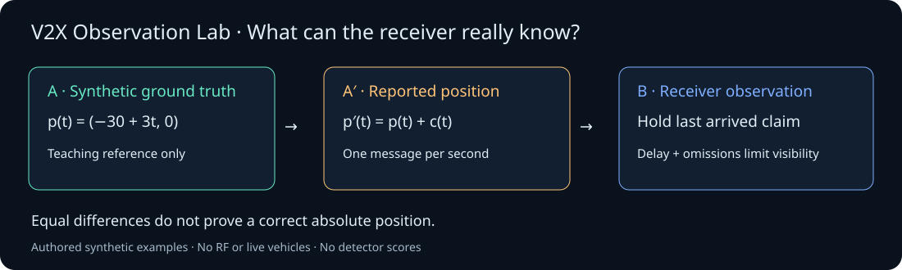

# V2X Observation Lab

A browser-local tool for exploring receiver observation limits under
application-level constant-position-offset V2X messages. All scenarios and exports are authored synthetic examples generated by
documented formulas. There are no learned model scores or measured traces.



[Live demo](https://v2x.tcybertrust.id.vn/) ·
[Releases](https://github.com/thaocyber/V2X-Observation-Lab/releases) ·
[Bug reports](https://github.com/thaocyber/V2X-Observation-Lab/issues/new/choose) ·
[Private security reports](https://github.com/thaocyber/V2X-Observation-Lab/security/advisories/new)

## Run

From this folder, with Python 3 available:

```sh
python3 -m http.server 8095 --bind 127.0.0.1 --directory web
```

Open http://127.0.0.1:8095/. Keep the terminal running; Ctrl+C stops it.
Any static HTTP server can serve `web/`. No package installation, account, API,
CDN, database, model or Internet connection is needed after obtaining the files.
A WebGL-capable browser enables 3D; coordinate and message tables work without it.

## Explore

The current V2X scenario is one-way V2V: vehicle A sends a position claim and
vehicle B holds the latest arrival. The communication panel shows sent, pending,
configured-omission and received counts from the existing synthetic schedule.
Expand its event log to inspect send/omit/receive events up to playback time.
This is a simulation-wide teaching view: B does not know configured omissions.
There is no radio link, acknowledgement exchange, RSU or CAM/BSM wire encoding.

Start with a one-click preset: no offset, constant offset, or offset with delay
and periodic omissions. Each includes a guided observation. Timeline buttons
seek to the applied start, middle and end; start is inclusive and end exclusive.
Sender-side changes can occur before the receiver sees any corresponding message.
The receiver pane hides the synthetic ground-truth overlay by default; enabling
it is a teaching aid, not information available to the receiver.

Choose oblique or top-down viewing, show/hide position history, or expand a pane.
Mint marks A (synthetic truth), gold marks A′ (the claim), and blue marks B
(the receiver). Dots are samples; dashed links show sample order, not a verified
physical route. The receiver history contains only arrived claims. Camera framing
uses each pane's visible data; hidden truth cannot move the receiver camera.
Rewinding or resetting rebuilds histories without retaining future points.

Sender differences use consecutive sent messages; receiver differences use the
last two arrived messages and show their send-time gap. These may be different
pairs. Equal differences do not prove an absolute position is correct.


1. Change X/Y offset, active interval, fixed reception delay or periodic omissions.
2. Apply the scenario; play, pause or seek through its 20-second timeline.
3. Compare true position, reported position and the last received claim.
4. Inspect position differences at onset, within the interval and at termination.
5. Export/import scenario JSON to reproduce the same scene. Export the generated
   trace separately for inspection; a trace is not a scenario-import file.

Offsets are active on `[start, end)`. Messages are sent at integer seconds,
including 0 and 20. Messages received after 20 seconds remain outside playback.
The receiver holds the last received claim; it does not extrapolate. Wireframe
markers show synthetic ground truth for visual comparison only. Omission is an
explicit setting, not measured packet loss. Export always uses the last applied
configuration; pending form edits are not silently applied.

The scene does not simulate RF, GNSS, certificates, collisions or driver response.
Geometry checks are teaching checks, not attack detection or safety evaluation.
See [data format](docs/DATA_FORMAT.md) and [release scope](docs/RELEASE_SCOPE.md).

## Verify

Python 3.10+ and Node.js 20+ are sufficient; no Python packages are required:

```sh
python3 scripts/verify_public.py
```

The check verifies the reviewed file inventory, local links/module dependencies,
and deterministic model behavior in a temporary copy. Optional JSON output:

```sh
python3 scripts/verify_public.py --report /tmp/v2x-public-check.json
```

After intentional edits, inspect the changed files, update the manifest using
`python3 scripts/verify_public.py --refresh`, and rerun checks. A manifest records
bytes, not a guarantee that content is appropriate for publication.

## Reproduction report and demonstration

Use section 04 to download a JSON report or Markdown summary. Reports contain the
applied configuration, current playback instant, tool version, full synthetic
trace and sender/receiver geometric comparisons. See [report format](docs/REPORT_FORMAT.md).
The full trace is an authored schedule, not everything known to the receiver.

Follow the [five-minute demo](docs/DEMO.md). Read the
[Arsenal submission draft](docs/ARSENAL_DRAFT.md),
[release checklist](docs/RELEASE_CHECKLIST.md) and [changelog](CHANGELOG.md).
This release is an MVP, not a detector, real-world exploit or standards certification.

## Contribute

See [CONTRIBUTING](CONTRIBUTING.md), [SECURITY](SECURITY.md) and
[third-party notices](THIRD_PARTY_NOTICES.md). Vietnamese and English are welcome.
Project code is MIT licensed; preserve notices. Repository: [thaocyber/V2X-Observation-Lab](https://github.com/thaocyber/V2X-Observation-Lab).
GitHub issue and pull-request templates are included.

For hosting, publish only `web/`. The public demo runs on Cloudflare Pages.
The offline bundle uses the same files; no backend inference is offered.

## Automated checks

`VALIDATION.json` contains the local implementation check report.
Browser verification limits are documented in [docs/BROWSER_QA.md](docs/BROWSER_QA.md).
[GitHub Actions](https://github.com/thaocyber/V2X-Observation-Lab/actions)
runs [.github/workflows/check.yml](.github/workflows/check.yml) on pushes and pull
requests. It verifies the reviewed inventory, local links and synthetic tests,
and uploads a `public-package-validation` JSON artifact. Check the run for the
specific commit before treating it as passing. These checks do not block
Cloudflare deployment automatically.
