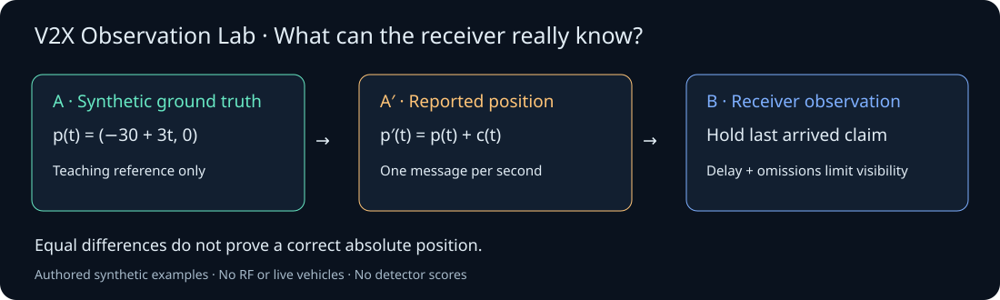

# V2X Observation Lab

An open-source, browser-local tool for exploring what a vehicle can learn from
received position claims, teaching observation limits, and inspecting supplied
binary evaluation results.

**Status: working MVP (0.2.0-dev).** The bundled scenes and evaluation sample are
synthetic. The Inspector can also review user-supplied predictions and labels;
it does not run a model or establish deployment readiness.

[Live demo](https://v2x.tcybertrust.id.vn/) ·
[Documentation](https://v2x.tcybertrust.id.vn/docs/) ·
[Project overview](docs/PROJECT_OVERVIEW.md) ·
[Changelog](CHANGELOG.md)



## Start here

| Workspace | What you can do | Open |
| --- | --- | --- |
| Learning Lab | Predict what B can know, reveal two different realities, then create and share a lesson. | [Try a lesson](https://v2x.tcybertrust.id.vn/learn/) |
| Observation Playground | Compare truth, position claims and retained messages; vary offset, delay and omissions. | [Explore scenarios](https://v2x.tcybertrust.id.vn/) |
| Evaluation Inspector | Import binary results, inspect errors and export scoped evidence with reviewer notes. | [Review evidence](https://v2x.tcybertrust.id.vn/evaluate/) |

Start with the Learning Lab, then explore the Playground. Evaluation review is a
separate workflow: imported prediction rows are not mapped into the 3D scene.
The homepage includes a narrated illustrated overview with captions and transcript.

## Run locally

With Git and Python 3 installed:

```sh
git clone https://github.com/thaocyber/V2X-Observation-Lab.git
cd V2X-Observation-Lab
python3 -m http.server 8095 --bind 127.0.0.1 --directory web
```

Open http://127.0.0.1:8095/. Keep the terminal running; Ctrl+C stops it.
Any static HTTP server can serve `web/`. No package installation, account or remote
API is needed to use the downloaded bundle. Use HTTP/HTTPS rather than `file://`;
WebGL enables 3D, and the Inspector requires HTTPS or localhost for hashing.

The interface and bundled examples use English. Imported text retains its original
language. Files are processed in the browser; export your work before leaving.

## Documentation

- [English user guide](docs/USER_GUIDE.md) and [four-page PDF](web/docs/v2x-observation-lab-guide.pdf): scope, installation and all three workspaces.
- [Documentation index](docs/README.md): formats, walkthroughs, development and verification.
- [Five-minute walkthrough](docs/DEMO.md): a reproducible Playground demonstration.
- [Current scope and limitations](docs/RELEASE_SCOPE.md): implemented behavior and boundaries.

## Evidence boundaries

A constant offset can preserve position differences within an unchanged-offset
segment. Equal differences therefore do not prove a correct absolute position.
Sampling gaps and stale messages are not automatically attacks. Ground truth is
available to the analyst in the synthetic scene, not assumed to be known by B.

Evaluation labels and provenance are supplied by the importer. Metrics describe
those records; they do not authenticate labels or establish real-world performance.
The tool does not implement RF transmission, CAM/BSM wire encoding, collisions,
live AI inference or safety certification.

## Verification and development

With Python 3.10+ and Node.js 20+:

```sh
python3 scripts/verify_public.py
```

Checks cover the reviewed inventory, local references and deterministic behavior.
See [verification records](docs/qa/README.md) for the tested scopes and remaining
limits, and [GitHub Actions](https://github.com/thaocyber/V2X-Observation-Lab/actions)
for results on individual commits. These are implementation checks, not a benchmark.

[Maintainer guide](docs/MAINTAINING.md) ·
[Evidence-review roadmap](docs/ASSURANCE_PLAN.md) ·
[Learning roadmap](docs/LEARNING_ROADMAP.md) ·
[Releases](https://github.com/thaocyber/V2X-Observation-Lab/releases)

## Contributing and license

See [Contributing](CONTRIBUTING.md), [Security](SECURITY.md) and
[third-party notices](THIRD_PARTY_NOTICES.md). Vietnamese and English contributions
are welcome; bundled UI text stays English. Project code is [MIT licensed](LICENSE).
Preserve bundled dependency notices.

[Report a bug](https://github.com/thaocyber/V2X-Observation-Lab/issues/new/choose) ·
[Report a vulnerability privately](https://github.com/thaocyber/V2X-Observation-Lab/security/advisories/new)
